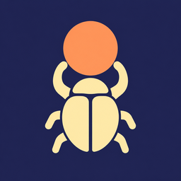

# DayBreak

An open-source iPhone and Apple Watch app that compares **how rested you feel** with **Apple's Sleep Score** and **the last sleep stage your Watch recorded**.

## Why this exists

[Apple's Sleep Score](https://support.apple.com/en-us/108906) uses estimates of sleep duration, bedtime consistency, and interruptions. It doesn't ask how refreshed you feel when you wake up. A high score and low restedness can both be real observations; they answer different questions.

DayBreak keeps the two numbers separate. Rate your restedness from **1–5 before seeing the score**, then pair it with the **exact 0–100 number Apple displayed** for that morning. The chart shows the relationship across mornings and calls out high-score mornings when you didn't feel rested. The mismatch is worth seeing on its own, not averaging away into another score.

This is a personal comparison, not a claim that the watch is wrong or that either number diagnoses a sleep problem. The app leaves missing values blank, and the results stay on your devices.

## Interface

In **Settings → Appearance**, choose **Thermocline** (default) or **Paper & Ash**, the original theme with serif prompts. Preview both themes, then pick System, Light or Dark. Thermocline offers seven accents; Paper and Ash each keep their original accent. Changes show immediately and carry to the paired Watch, which always uses the dark palette. The scarab and sunrise remain the app icon.

## Use it

1. Open **DayBreak** on your Watch or iPhone after waking. Choose how rested you feel before looking at Apple’s score. The Watch saves your response locally and tries to transfer it directly to the paired iPhone. “Received by iPhone” means the phone acknowledged the rating payload; the earliest report of the day is the one shown if you entered both.
2. **Automatic alert import (optional):** on iPhone, enable **Settings → Save alert scores automatically**, then configure the **Check In from Apple Sleep Alert** Shortcuts action with the original notification’s **Body**, **Date**, **Title**, and **App**. The Notification trigger must be limited to **Health** and titles containing **Sleep Score**, with **Automation** and **Allow Running When Locked** enabled and **Show When Run** off. Recognized English Sleep Score alerts can then save a score without typing or confirmation, before or after a rating. The score stays hidden until you rate. It is labeled **copied from a Health alert, not independently verified**—not a direct HealthKit read or a reconstructed estimate. The original receipt must be on the current local day and no more than two hours old; the title’s band must agree with one clear supported score field. Missing metadata, unknown formats, conflicts and scores you removed leave a gap. Existing scores and unconfirmed candidates are not replaced. Completing this setup does not prove real Apple alerts contain a readable score or arrive while locked; validate the real alert against the same-date Health chart. [Apple does not expose its exact Sleep Score via the public HealthKit API](https://developer.apple.com/forums/thread/800403) (Apple Developer Technical Support, September 2025; checked against the iOS/watchOS 27.2 public SDKs). With automatic import off, manual entry and user-selected screenshot OCR remain available. The app does not save screenshots. To add a score later, select that wake date under **Compare → Morning history**.
3. Enable **Settings → Log sleep stages** on iPhone and allow Sleep read access in Health. DayBreak records the last unambiguous **Core, Deep, or REM** segment from qualifying Apple Watch sleep before a rating. It checks the date in the rating’s original timezone and ignores later naps, manual entries, non-Watch samples, and unstaged sleep as a stage label. A match requires at least one hour of asleep samples in the latest qualifying session and a session ending within four hours before the rating on the same wake date. This is the [last Apple Watch estimate](https://developer.apple.com/documentation/healthkit/hkcategoryvaluesleepanalysis), not a measurement of your exact wake instant. DayBreak retries recent rated mornings when it can read Health, including after opening the app; open an older rated morning in **Compare → Morning history** to read its stage. Missing or ambiguous data are not filled in, and turning logging off stops future reads without deleting stages already saved.
4. **Compare** charts the score/rating pairs, counts missing scores, and shows how often a high Apple score (81–100) coincided with low restedness (1–2). A tie-aware Spearman rank correlation appears when there are at least five pairs and both measures vary. The separate stage comparison groups mornings by stage and shows median restedness and, when confirmed scores exist, median Sleep Score, with the count for each measure. Small groups are descriptive, not an explanation of why you felt rested. Titles and views are in English.

## Choose a prompt source on iPhone

Automatic prompts start **off**. Manual check-ins always work.

- **When Watch sleep data arrives:** in Settings, select this mode and allow notifications and sleep read access. The app observes `.sleepAnalysis` and merges overlapping and nearby Apple Watch asleep intervals. To qualify for a prompt, the session must contain at least three hours of asleep intervals and end within two hours on the current local day. This can miss short nights or late syncs and is not live wake detection. DayBreak rechecks after unlock when iOS lets it run, and when you next open the app. No alarm, Sleep Focus, polling, third-party cloud, or overnight workout is required.
- **Apple Sleep Score alert experiment (iOS 27):** a Notification automation for the actual iPhone sender can invoke **Check In from Apple Sleep Alert**. Prompt mode and automatic score saving are independent. Pass the original **Body**, **Date**, **Title**, and **App** for automatic saving; never replace the original Date with the shortcut’s run time. With automatic saving off, a supplied value remains an unconfirmed candidate. Watch-only alerts are not established as an iPhone trigger. Apple can show its banner first; a rating after seeing the number is not blind.
- **Watch sleep or iPhone alert:** enable both routes above. Either can queue the check-in without waiting for the other; once iOS accepts one for the wake date, the later signal does not queue a second. The shorter route depends on when the signals are available, not on the Sleep Score number. Your existing prompt mode is not automatically changed by an upgrade.
- **Routing test:** tap **Test Watch notification routing** and lock your iPhone while keeping your Watch unlocked and on your wrist. A neutral notification is scheduled about 12 seconds later. It never creates a diary entry. Apple decides whether to deliver iPhone-originated local notifications to the phone or the Watch, based on device state and notification settings. This tests notification routing, not wake detection.

If a check-in is missing, look in **Settings → Prompt source → Last prompt checks**. For each enabled route, this shows the last check's time and technical outcome (for example, the Health store was locked or iOS did not allow notifications). “iOS accepted the check-in” means it was submitted to the system, not that you saw a banner. If a previous attempt could not record its result, DayBreak does not retry that date, to avoid a duplicate. You can still check in manually. Only the latest result per source is saved locally. This diagnostic file contains no sleep intervals, scores, or alert text.

## Open the project

Open `MorningCheck.xcodeproj` in Xcode. The iPhone target uses iOS 18+ APIs and the Watch target uses watchOS 11+ APIs; these are deployment targets, not a verified compatibility matrix. The exact Apple Sleep Score feature and the optional Shortcuts notification automation have separate Apple OS requirements.

- For a simulator check, choose scheme **MorningCheck**, an iPhone simulator, then Run or Test. To open the Watch app separately, choose scheme **MorningCheckWatch** and a paired Watch simulator.
- For a real-device trial, select your own Xcode signing team for both targets. If Xcode asks for unique bundle IDs, keep the watch ID prefixed with the phone ID and set the Watch Info `WKCompanionAppBundleIdentifier` to the new phone ID. Enable the phone's HealthKit and HealthKit Background Delivery capabilities. Run on the physical iPhone and open the companion once on its paired Watch. A local install on both devices with a free Personal Team has been verified. [Personal Team profiles expire after seven days](https://developer.apple.com/help/account/basics/about-your-developer-account/). This repository ships source only, not a signed app or a provisioning profile.
- `project.yml` is the reproducible [XcodeGen](https://github.com/yonaskolb/XcodeGen) spec. `xcodegen generate` recreates the Xcode project; reapply local signing changes afterward unless you added them to an unshared local configuration.

## Device validation checklist

1. **Confirm transfer.** On a paired device, record a real rating on your Watch when you intend to log it, with no score visible beforehand. Verify “Received by iPhone” and the same wake date and rating in the phone app. Repeat on another morning with the phone unavailable, then reconnect. Device arrival time must not replace the original rating time.
2. **Confirm timing.** With your chosen mode enabled, check several mornings, including an unscheduled wake. Note whether the prompt arrived before or after Apple’s alert, what device displayed it, whether tapping **Rate** landed on the check-in, and whether duplicates occurred. An alert that only arrived after unlock is not a real-time wake trigger. If the alert experiment does not fire, verify manual score capture before trying sleep-data mode.
3. **Confirm pairing.** Take or select the actual Sleep Score detail card for the same wake date on iPhone, inspect the OCR result, and confirm it only if it matches. Check the comparison view. Use manual entry if the card format or language prevents recognition.
4. **Confirm stage logging.** Enable sleep stage logging and check in before viewing Health. After the Watch syncs, compare the logged stage and the stage end time with **Health → Sleep → Show More Sleep Data → Stages** for the same wake date. Check **Compare → Morning history** and the stage group. A missing stage may mean the data has not synced, read access is off, or there is no unambiguous match. Stage logging does not prove notification routing worked.

## Privacy and boundaries

- No network client, analytics, account, CloudKit, or iCloud Drive. Apple Watch and iPhone exchange your rating payload, its receipt, and your appearance settings using Watch Connectivity. The paired phone holds the comparison. There is no Mac or iPad sync.
- Sleep access is optional and read-only. DayBreak can persist the stage label and the end time for a rated morning; it does not persist the raw intervals or alert text. The log lives in the app sandbox under Application Support with backup exclusion and protection until the first device unlock after restart, so transfers can be handled later in the background. To remove it, use **Erase iPhone log** and **Erase Watch log** separately. The iPhone ignores older queued Watch data after its log is erased. The app does not change Apple Health when you erase its log.
- HealthKit exposes predefined data types; a third-party app cannot add a custom numerical Restedness chart to Apple Health. The two numbers appear together in DayBreak, **not** inside Health. No private API or spoofed symptom data is used.
- This is a personal tracking prototype, not a medical tool, a validated diagnostic test, or a claim that Sleep Score should match subjective restedness on any particular morning.

## How the open-source pieces informed the build

- [Pulso’s observer at commit `9676cf7`](https://github.com/lenilsonjr/pulso/blob/9676cf77040205d1b0c8b7308f99a3135a0a2006/Pulso/Sync/TriggerHub.swift) is the reference for reacting to saved HealthKit samples and acknowledging an observer after work. This app swaps the server sync for a local, deduplicated user prompt. No Pulso code is vendored.
- [Sleep Trigger](https://github.com/Padasdaf/Sleep-Trigger) is a public reference for a Watch-to-phone signal. Its live sensor approach uses a workout session; this app does not use that approach, and does not copy its implementation.
- [Apple: HealthKit background delivery](https://developer.apple.com/documentation/healthkit/hkhealthstore/enablebackgrounddelivery(for:frequency:withcompletion:)), [Watch Connectivity transfers](https://developer.apple.com/documentation/watchconnectivity/wcsession/transferuserinfo(_:)), [notification forwarding](https://developer.apple.com/documentation/watchos-apps/taking-advantage-of-notification-forwarding), [Vision text recognition](https://developer.apple.com/documentation/vision/vnrecognizetextrequest), [Shortcuts notifications, WWDC 2026](https://developer.apple.com/videos/play/wwdc2026/310/), [HealthKit data types](https://developer.apple.com/documentation/healthkit/about-the-healthkit-framework), [App Review health data rules](https://developer.apple.com/app-store/review/guidelines/#health-and-health-research).
- The rating anchors are adapted from the expanded [Consensus Sleep Diary](https://pmc.ncbi.nlm.nih.gov/articles/PMC3250369/) (Carney et al., *Sleep*, 2012); this app does not implement the full diary.

## Run the checks

`swift test` runs the core tests. To also run OCR against an actual screen layout, download the [public illustration linked from Apple Support 108906](https://cdsassets.apple.com/live/7WUAS350/images/health/ios-27-iphone-17-pro-health-sleep-sleep-score.png), then pass its local path as `MORNING_CHECK_APPLE_FIXTURE` to `swift test`. The image is not shipped with the source. Run the **MorningCheck** scheme’s UI tests on an iPhone simulator to verify the rating-first flow, workspace switcher, comparison view, and appearance choices. The tests use a disposable in-memory diary and isolated appearance preferences. Watch Connectivity background transfers and HealthKit background delivery are not verified by simulators.

## Contributing

Device and OS versions, steps to reproduce, and redacted logs are helpful in bug reports. Please don't attach Apple Health exports, personal ratings, or screenshots containing health or account data to public issues. For a privacy bug, use GitHub's private vulnerability reporting if available.

DayBreak is [MIT licensed](LICENSE) and is not affiliated with Apple.
